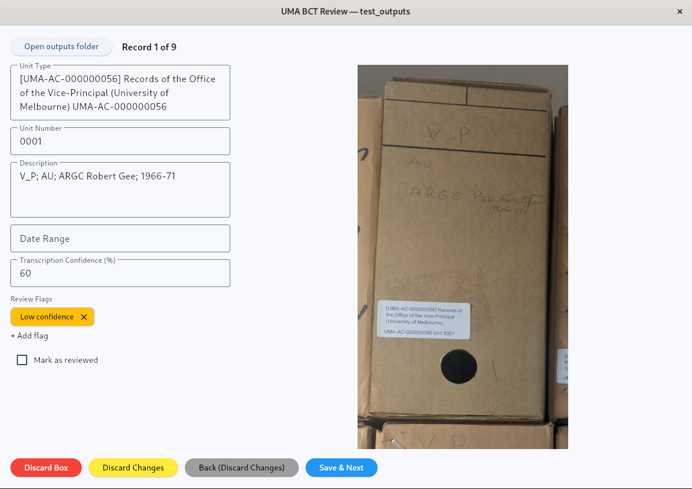

# UMA Box Contents Transcription Review GUI

A desktop app for reviewing box catalogue transcriptions against their source images. Built with Flet for Windows, macOS and Linux.

This is the review companion to the main [UMA Box Contents Transcription CLI](https://github.com/itproj-uma-box-contents/uma-bct-cli). Use the CLI to generate catalogues and cropped box images, then use this app to correct fields, manage review flags and mark records as reviewed.



## Quick start

Requires **Python 3.12+**, **[uv](https://docs.astral.sh/uv/)** and a desktop session.

```sh
git clone https://github.com/itproj-uma-box-contents/uma-bct-gui.git
cd uma-bct-gui
uv sync --locked
uv run main.py
```

The first launch may download the native Flet client; launch once while online before working offline. Desktop and Excel support are included.

On Ubuntu, install the folder picker and default-app opener:

```sh
sudo apt install zenity xdg-utils
```

## Review a catalogue

1. Select **Open outputs folder** and choose a CLI output directory containing `catalogue.csv` or `catalogue.xlsx` and its `Box Images` folder.
2. Compare each record with its image, correct fields, add or remove flags, tick **Reviewed** and select **Save**.
3. Move with **Prev/Next** or **Left/Right** arrows when outside a text field. Use **View records** to revisit a fully reviewed catalogue.

Scroll to zoom and drag to pan, or use the zoom and fit buttons. The sun/moon button switches themes and remembers your preference.

**Discard changes** resets unsaved edits; **Discard box** permanently removes the record from the catalogue after confirmation. Unsaved edits prompt before navigation, switching folders or closing. Failed saves keep your edits available to retry.

**Open catalogue** opens the selected file in your default spreadsheet app, with a choice to save first or open the saved version. Close that app before continuing GUI edits. External file changes require reopening the outputs folder; automatic merging is not supported.

## Files and compatibility

- Catalogue filenames are case-insensitive. If CSV and XLSX both exist, the newest is selected; CSV wins a timestamp tie. Only the selected file is updated. Keep one catalogue per format.
- Keep the CLI's column headings and folder structure. Move the catalogue and `Box Images` together. Relative paths, local file URLs, Excel hyperlinks and literal-path `HYPERLINK` formulas are supported; absolute paths from another computer may need updating. Missing-box records may have no image.
- **CSV:** comma-separated UTF-8; saves include a BOM for Excel. Import identifier columns as **Text** to preserve leading zeros, and use text import or XLSX for literal transcription text beginning with `=`.
- **XLSX:** uses the `Catalogue` worksheet, or the active sheet if absent. Ordinary edits preserve unchanged cell types, formatting, comments, sheets and image links. Edited identifiers retain leading zeros. Protected sheets must be unprotected before saving. Unsafe row deletion is refused; use a plain catalogue copy for workbooks with advanced Excel features.
- **Apple Numbers:** export to CSV or XLSX before opening in the GUI; `.numbers` files are unsupported.

Excel does not need to be installed or licensed. Files and their containing folder must be writable; spreadsheet locks still apply. Saves use a temporary file before replacing the original.

## Development and contributions

Issues and pull requests are welcome. Include reproduction steps for bugs and run the tests before submitting changes:

```sh
uv run --locked python -m unittest discover -s tests -v
```

CI runs on Ubuntu, Windows, Intel macOS and Apple Silicon macOS with Python 3.12. For native rendering checks on a desktop:

```sh
uv run --locked python tests/desktop_smoke.py
```

The smoke test uses disposable fixtures; folder pickers and external app launching need manual checks. Repeated macOS runs can intermittently fail native rendering checks.

For hot reload:

```sh
uv pip install "flet-cli==1.0.4"
uv run --no-sync flet run
```

An installed package also provides the `uma-bct-gui` command.
