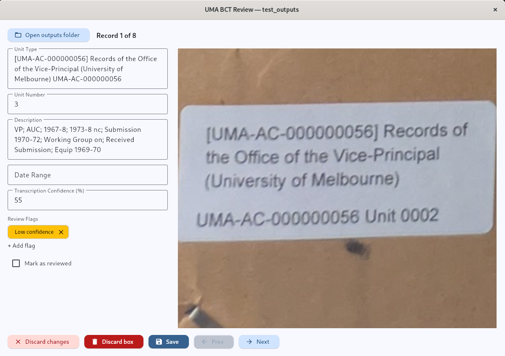
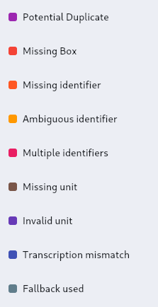

# UMA Box Contents Transcription Review GUI

This repository provides a graphical user interface for manually reviewing the outputs of the [UMA Box Contents Transcription CLI](https://github.com/itproj-uma-box-contents/uma-bct-cli).

It is based on the lofi mockup [in Confluence](https://uma-box-contents.atlassian.net/wiki/x/AQC_/).

The GUI has one page only. It is shown in the following screenshot:


It also allows users to zoom in on the image as shown



The following screenshot (of the "Add flag" menu) shows the flags available and the colour-coding used:



## Setup

```
uv sync
```

## Usage

> [!NOTE]
> At a later date, we can [package this nicely](https://flet.dev/docs/publish/) so the archivists who use the GUI (who might be different from those who use the CLI) don't have to launch it through the command line anyway.

> [!NOTE]
> The GUI relies on the supplied directory having the structure that the current CLI produces. Changes in the CLI to the structure of the output directory will require (minor) changes to this GUI.

```
uv run main.py
```

Alternatively, use `uv run flet run` to enable hot-reloading of the GUI on code-changes.

An installed package can also be launched with `uma-bct-gui`.

The GUI opens with nothing loaded. Use the "Open outputs folder" button to pick a CLI outputs directory (one containing `catalogue.csv` or `catalogue.xlsx`) through the OS folder picker.

Unsaved changes are checked before moving between records, opening another folder, or closing the window. Failed saves keep your edits available to retry. If another program changes the catalogue, the app asks you to reopen the folder rather than overwrite those changes.

Use the image's Zoom in, Zoom out and Reset / Fit buttons, or scroll to zoom and drag to pan. The status shows reviewed and remaining counts. If every record is reviewed when a folder opens, use "View records" to revisit them.

### Excel (`catalogue.xlsx`) support

Reading and writing `.xlsx` catalogues needs `openpyxl`, which is an optional dependency (the `excel` extra) so CSV-only users don't have to install it:

```
uv run --extra excel main.py
```

(or `uv sync --extra excel` once, to install it into the project environment). If a folder only has a `catalogue.xlsx` and the extra isn't installed, the GUI says so instead of failing. If a folder has both a `.csv` and an `.xlsx`, the more recently modified one is used. Saving updates changed cells, preserving existing formatting, comments, cell types and image hyperlinks. New `Reviewed` values are stored as real TRUE/FALSE cells. Both formats are saved to a temporary file before replacing the original.

## Tests

```
uv run --extra excel python -m unittest discover -s tests -v
```

CSV and GUI tests also run without the Excel extra; the Excel tests are skipped.
